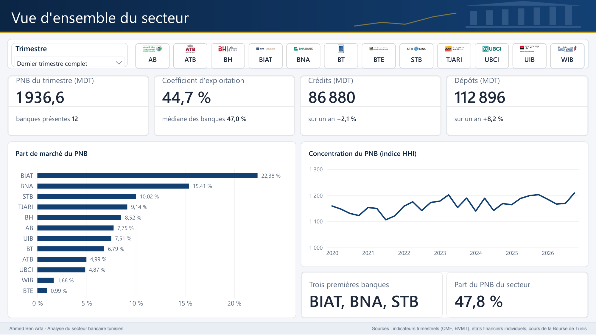
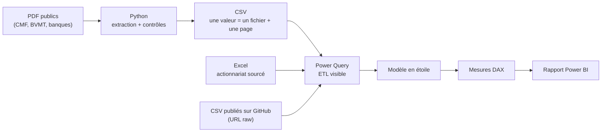
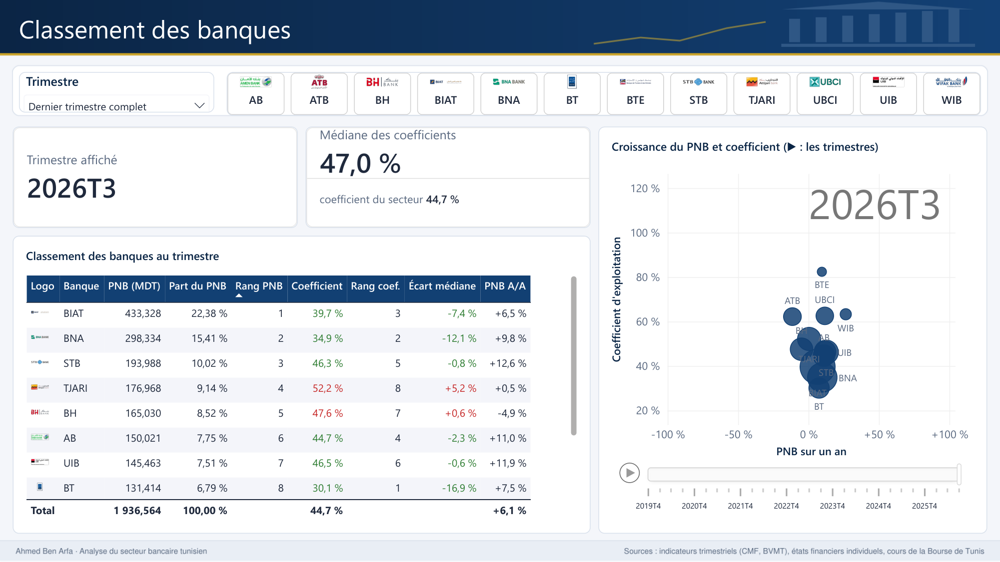
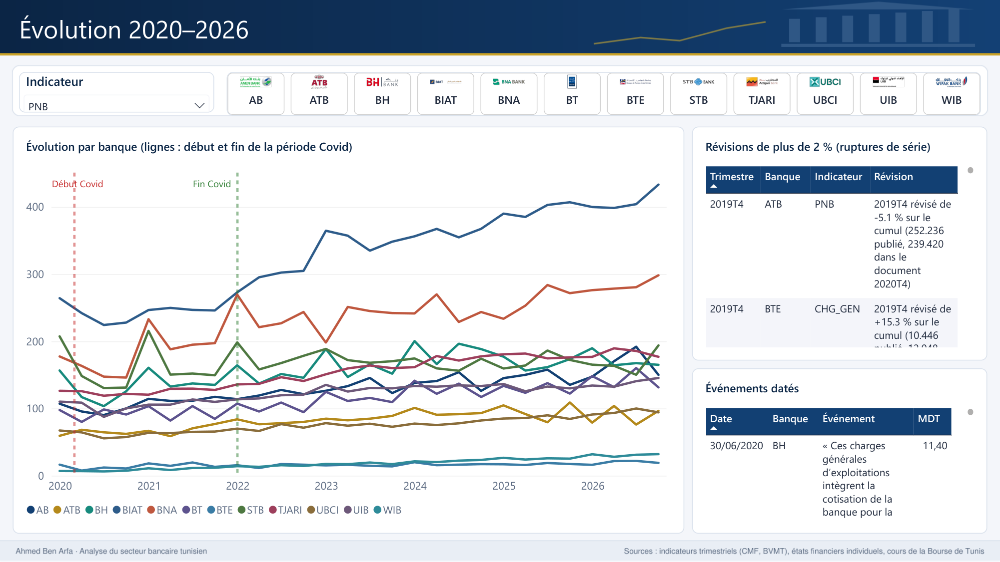

<!-- Auteur : Ahmed Ben Arfa -->
# Analyse du secteur bancaire tunisien (2019–2026)

> **In English.** A Power BI portfolio project comparing the 12 banks listed on the Tunis Stock
> Exchange, quarter by quarter from Q4 2019 to Q3 2026. Data come from the banks' public quarterly
> activity reports (PDF, published through the CMF and the BVMT), their financial statements and
> daily stock prices. A Python pipeline extracts every figure with its source file and page; revised
> figures, consistency checks and manual entries are tracked. The data layer, the Power Query layer
> (22 queries), the star schema and the DAX measures (154) are complete; three of the nine report
> pages are finished (sector overview, bank ranking, 2020–2026 trends) and the others are in
> progress. Figures are provisional and unaudited.
> Documentation is in French.



Ce projet construit un rapport Power BI qui compare l'activité, l'efficacité et la structure des
12 banques cotées à la Bourse de Tunis, trimestre par trimestre, et met en regard leur performance
opérationnelle et leur performance boursière. Chaque chiffre vient d'une publication publique et
garde le fichier et la page d'où il vient ; aucune valeur n'est estimée.

Questions d'analyse :

1. Quelles banques ont le PNB le plus élevé, et lesquelles gagnent des parts de marché ?
2. Quelles banques sont les plus efficaces (coefficient d'exploitation) et comment cela évolue-t-il ?
3. D'où vient le PNB de chaque banque (marge d'intérêts, commissions, portefeuille-titres) ?
4. Comment ont évolué crédits et dépôts, et le ratio crédits / dépôts ?
5. Le secteur se concentre-t-il (indice HHI) ?
6. Quel a été l'effet du Covid (2020–2021) et comment le secteur s'est-il redressé ?
7. La Bourse récompense-t-elle les banques les plus performantes ?

L'idée vient d'un rapport Power BI publié sur LinkedIn sur les ratios des banques cotées au
30/06/2026, construit à partir des mêmes publications trimestrielles. Ce projet y ajoute
l'historique sur 28 trimestres, les contrôles, la traçabilité de chaque valeur, la rentabilité
(ROE, ROA) et le volet boursier.

## Périmètre et sources

| Élément | Choix |
|---|---|
| Banques | AB (Amen Bank), ATB, Attijari Bank, BH Bank, BIAT, BNA, BT, BTE, STB, UBCI, UIB, Wifak International Bank |
| Période | T4 2019 → T3 2026 (le T4 2019 sert de base aux évolutions sur un an de 2020) |
| Unité | Millions de dinars (MDT) |

| Source | Contenu | Utilisation |
|---|---|---|
| Indicateurs d'activité trimestriels (sites de la BVMT et du CMF, liste du CMF, Bulletins Officiels du CMF, deux documents sur les sites de la Bourse de Tunis et de Wifak) | PNB, produits et charges d'exploitation, frais de personnel, charges générales, crédits, dépôts, capitaux propres | Indicateurs trimestriels |
| États financiers individuels annuels et semestriels (BVMT, liste du CMF, Bulletins Officiels) | Résultat net, total de l'actif, capitaux propres | ROE, ROA |
| Archives de cotation de la BVMT (2019–2025), bulletins quotidiens de la Bourse de Tunis (2026), ilboursa (volumes 2026) | Cours quotidiens, opérations sur titres | Volet boursier |
| Fiches émetteurs de la Bourse de Tunis, états financiers, rapports annuels des banques | Actionnaire de référence, contrôle | Segmentation par actionnariat |

## Chaîne de traitement



Python ne fait que lire les documents : tout ce qui peut se faire dans Power Query (fusions,
dépivotages, colonnes conditionnelles, ajustements des cours) s'y fait, pour que la préparation des
données reste visible dans le rapport. Trois types de sources sont utilisés : un dossier de CSV,
un fichier Excel et une URL.

## Aperçu du rapport

Trois pages sur neuf sont terminées et vérifiées (captures exportées de Power BI Desktop, données au
T3 2026). Chaque page est décrite, avec sa lecture et ses choix de conception, dans
[docs/Presentation_rapport.pdf](docs/Presentation_rapport.pdf).

| Page | Ce qu'elle montre |
|---|---|
| [Vue d'ensemble du secteur](docs/captures/page1_vue_ensemble.png) | PNB, coefficient d'exploitation, crédits et dépôts du secteur au dernier trimestre complet ; parts de marché du PNB ; concentration (indice HHI) de 2019 à 2026 |
| [Classement des banques](docs/captures/page2_classement.png) | rangs au PNB et au coefficient d'exploitation harmonisé, écart à la médiane en couleur ; nuage croissance × efficacité animé trimestre par trimestre |
| [Évolution 2020–2026](docs/captures/page3_evolution.png) | courbes par banque sur l'indicateur choisi (paramètre de champ), période Covid marquée, révisions et événements qui expliquent les sauts de série |





## Chiffres clés (au 30/10/2026)

| Élément | Valeur |
|---|---|
| Documents d'indicateurs trimestriels trouvés | **336 / 336** (12 banques × 28 trimestres) |
| Valeurs retenues des indicateurs trimestriels | 11 545 (24 indicateurs, aucune vide) |
| Valeurs relevées à la main sur l'image des PDF pour les tests | 438 sur 41 documents d'indicateurs, 169 sur 24 états financiers |
| Contrôle annuel (somme des 4 trimestres contre cumul annuel) | 288 contrôles : 205 ok, 41 en attente de révision, 20 ruptures de série, **22 écarts, tous expliqués** (11 retraitements de la banque, 7 erreurs dans le document de la banque, 3 reclassements, 1 arrondi, 0 erreur d'extraction) |
| Révisions de plus de 2 % d'un total (cumul) | 137, chacune avec le document d'origine et le document révisé |
| Valeurs saisies à la main | 682 (13 documents BTE publiés en image, deux valeurs STB superposées au libellé, deux valeurs Wifak dont les colonnes se touchent), toutes passées aux contrôles de cohérence ; un document relu une seconde fois en entier (BTE 2020T2) |
| États financiers | 168 arrêtés, 504 valeurs retenues (résultat net, total de l'actif, capitaux propres), aucune vide |
| Cours boursiers | 1 955 séances par banque, du 02/01/2019 au 20/10/2026 ; 63 opérations sur titres, chacune avec le cours de référence publié |
| Modèle Power BI | 22 requêtes Power Query, table des dates (période Covid), 32 relations, 154 mesures DAX vérifiées une à une contre des valeurs calculées à part |
| Tests automatiques | 48, tous réussis |

## Démarche qualité

- **Versions révisées.** Les banques corrigent souvent leurs chiffres de l'année précédente.
  Chaque valeur est gardée dans toutes ses versions (publiée dans le document du trimestre,
  révisée dans le document de l'année suivante) ; la version révisée est retenue, et une
  révision de plus de 2 % du cumul est marquée comme rupture de série. Les variations sur un an
  sont toujours calculées dans un même document.
- **Contrôles.** Produits − charges = PNB dans chaque colonne, PNB = marge d'intérêts + marge sur
  commissions + revenus du portefeuille dans chaque version publiée, trimestre contre cumul,
  composantes des charges opératoires, ordres de grandeur, somme des trimestres contre cumul annuel,
  équilibre du bilan. Chaque écart du contrôle annuel a sa cause et sa source dans `docs/ecarts_annuels.csv`.
- **Colonnes fausses écartées.** Deux colonnes de comparaison erronées dans les documents des
  banques (UIB 2023T2, Wifak 2023T4), vérifiées sur l'image, ne sont jamais retenues.
- **Saisies manuelles tracées.** Les documents publiés en image sont relevés à la main dans
  `saisies_manuelles.csv`, avec le fichier, la page, la valeur publiée, l'unité et la vérification ;
  le chargement refuse toute valeur incohérente avec son unité.
- **Événements identifiés.** Les ruptures expliquées sont décrites dans `evenements.csv`, avec la
  source : don au Fonds 1818 (Covid-19, 2020), moratoire Covid de l'UIB (2020), accord salarial du
  secteur (2021), retraitement BH (2024), déchéance fiscale BNA (2025).
- **Définitions harmonisées.** Le contenu des charges opératoires et des capitaux propres
  trimestriels varie d'une banque à l'autre (`gabarits.csv`) : les comparaisons utilisent un
  coefficient d'exploitation harmonisé et les capitaux propres du bilan.
- **Tests.** L'extraction est comparée aux valeurs relevées à la main sur l'image des documents.

## Structure du dépôt

```
├── collecte_banques.py          collecte et extraction des indicateurs trimestriels
├── scripts/                     états financiers, cours, PDF de docs/, outils de vérification, audit
├── tests/                       tests et valeurs relevées à la main
├── gabarits.csv                 mise en page de chaque banque par période
├── saisies_manuelles.csv        valeurs relevées sur les documents publiés en image
├── exclusions_colonnes.csv      colonnes de comparaison fausses, jamais retenues
├── evenements.csv               événements expliquant des ruptures (publié pour Power BI, URL raw)
├── operations_titres.csv        dividendes, attributions, division (publié pour Power BI, URL raw)
├── donnees_reference/
│   └── banques.xlsx             actionnariat des 12 banques, sourcé, une ligne par période
├── powerquery/                  requêtes Power Query (M)
├── dax/                         mesures DAX, table des dates, colonnes calculées, requêtes de contrôle
├── powerbi/                     projet Power BI (.pbip : modèle TMDL, pages PBIR) et thème du rapport
├── donnees_publiees/            CSV finaux lus par Power BI (versionnés, régénérés par un script)
├── docs/
│   ├── SPECIFICATION.md         spécification complète (modèle, mesures, pages, limites)
│   ├── utilisation.md           mode d'emploi des scripts
│   ├── guide_powerbi.md         requêtes et mesures expliquées pas à pas
│   ├── feuille_de_route.md      état d'avancement et décisions prises
│   ├── ecarts_annuels.csv       cause de chaque écart du contrôle annuel
│   ├── revisions_importantes.csv
│   ├── captures/                captures des pages terminées du rapport
│   └── *.pdf                    spécification, guide Power BI (chaque transformation expliquée), rapport d'avancement, présentation du rapport
└── donnees/                     dossier de travail : PDF et CSV produits par les scripts (non versionné)
```

Les CSV finaux sont dans [`donnees_publiees/`](donnees_publiees/LISEZMOI.md), pour que le rapport
puisse s'ouvrir après un simple clonage du dépôt. Pour reproduire les données depuis les PDF :
**[docs/utilisation.md](docs/utilisation.md)**.

## État d'avancement

| Étape | État |
|---|---|
| Collecte et extraction des indicateurs trimestriels (T4 2019 → T3 2026) | Terminé |
| États financiers (ROE, ROA), cours boursiers, opérations sur titres | Terminé |
| Examen des écarts du contrôle annuel, actionnariat des banques | Terminé |
| Requêtes Power Query (22 requêtes : dossier, Excel et URL ; dépivotage, fusions, colonnes conditionnelles, fonction personnalisée) | Terminé (détail et décisions : [docs/feuille_de_route.md](docs/feuille_de_route.md)) |
| Modèle en étoile, mesures DAX (32 relations, 154 mesures) | Terminé |
| Pages du rapport | En cours : 3 pages sur 9 terminées (vue d'ensemble, classement, évolution) ; suivantes : structure du PNB, bilan, Bourse, fiche banque, rentabilité, qualité des données |
| Note de validation par échantillon (`docs/validation.md`), captures du rapport | À faire |

## Limites

- Les indicateurs trimestriels sont **provisoires et non audités** : ils sont publiés par les
  banques elles-mêmes et souvent révisés l'année suivante.
- La somme des trimestres publiés peut différer du cumul annuel publié (retraitements en cours
  d'année) ; les chiffres annuels viennent toujours du cumul.
- Les définitions des postes diffèrent d'une banque à l'autre ; Wifak, banque islamique, est
  comparée par équivalences (marges et revenus assimilés pour les intérêts, financements pour les
  crédits).
- Le résultat net n'est pas dans les indicateurs trimestriels : ROE et ROA ne sont que semestriels
  et annuels ; les résultats semestriels ne sont pas audités.
- En dehors des valeurs de référence et des saisies manuelles, les valeurs ne sont pas relevées une
  à une : elles sont contrôlées par les règles de cohérence.
- Le seuil de 2 % pour signaler une révision importante est un choix d'analyse, pas une norme.

Le détail des limites est dans la spécification, section 10.

## Ouvrir le rapport

**Pour le consulter** : le lien de la version en ligne (« Publier sur le web », sans Power BI ni
compte) sera ajouté ici quand le rapport sera terminé. En attendant : captures et lecture des pages
terminées dans [docs/Presentation_rapport.pdf](docs/Presentation_rapport.pdf) ; préparation des
données, modèle et mesures expliqués étape par étape dans [docs/Guide_PowerBI.pdf](docs/Guide_PowerBI.pdf).

**Pour l'ouvrir dans Power BI Desktop** (Windows, gratuit) :

1. Cloner le dépôt (ou le télécharger en ZIP).
2. Ouvrir `powerbi/SecteurBancaireTunisien.pbip`. Le cache des données est versionné : le rapport
   s'ouvre avec ses données, sans autre réglage.
3. **Seulement pour actualiser** les données (après une nouvelle publication des CSV) :
   - **Accueil › Transformer les données › Gérer les paramètres** : donner à `CheminDonnees` le dossier
     du clone (par exemple `C:\Projets\Analyse-secteur-bancaire-tunisien`) ;
   - **Accueil › Actualiser** ; Power BI demande une fois, pour chaque source, un niveau de
     confidentialité (choisir le dossier du clone et **Professionnel**, ou « Organisationnel », pour
     toutes les sources) et, pour l'adresse GitHub, un mode d'accès (**Anonyme**). Ces réponses
     restent sur le poste ; aucune n'est enregistrée dans le projet.

Le rapport lit trois types de sources : le dossier `donnees_publiees/` (CSV), le fichier Excel
`donnees_reference/banques.xlsx` (actionnariat) et deux fichiers du dépôt par leur adresse GitHub
(`operations_titres.csv`, `evenements.csv`).

## Données

Les chiffres viennent de publications publiques : indicateurs d'activité et états financiers
publiés par les banques auprès du Conseil du Marché Financier (CMF) et de la Bourse de Tunis
(BVMT), documents des sites des banques, archives et bulletins de cotation de la Bourse, volumes
d'ilboursa. Les documents d'origine restent la propriété de leurs auteurs ; ils ne sont pas
redistribués dans ce dépôt (le dossier `donnees/` n'est pas versionné) : les scripts les
téléchargent depuis leurs adresses publiques. Les fichiers CSV du dépôt (`donnees_publiees/`)
donnent, pour chaque valeur, le document et la page d'où elle vient, et les manifestes l'adresse
de chaque document.

## Licence

Le code de ce dépôt (scripts Python, requêtes Power Query, mesures DAX) est publié sous licence
MIT : voir [LICENSE](LICENSE).

Les logos des banques (`donnees_reference/logos/`) sont la propriété de leurs banques respectives ; ils
servent uniquement à identifier chaque banque dans le rapport et ne sont pas couverts par la licence du
code (source de chaque logo : [`donnees_reference/logos/LISEZMOI.md`](donnees_reference/logos/LISEZMOI.md)).

## Auteur

Auteur : Ahmed Ben Arfa
