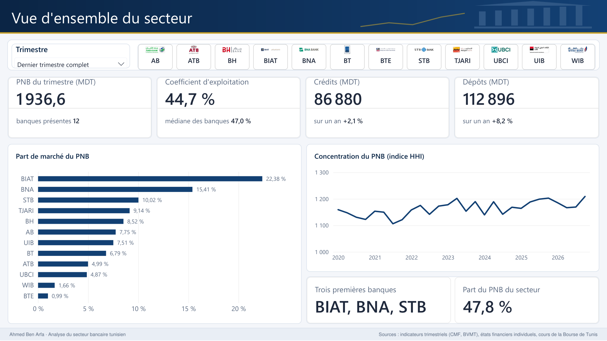
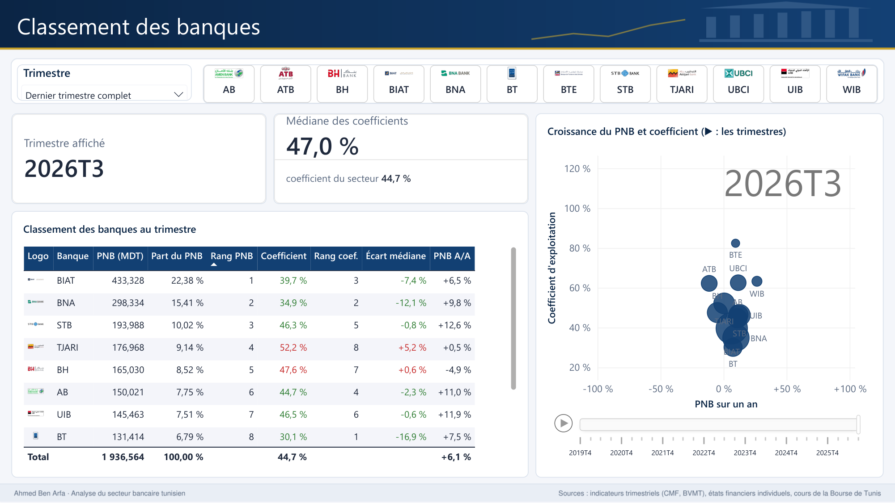
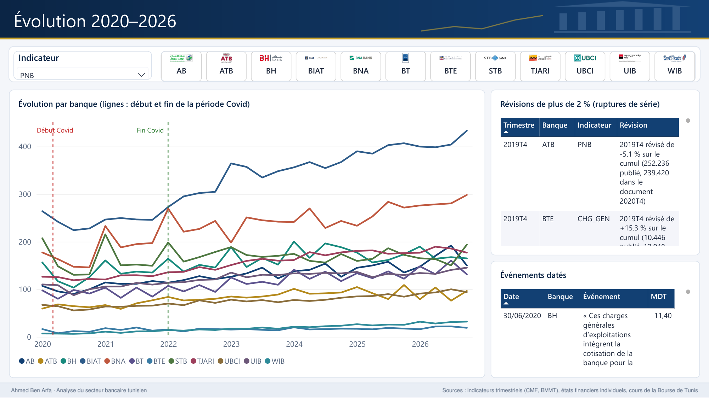
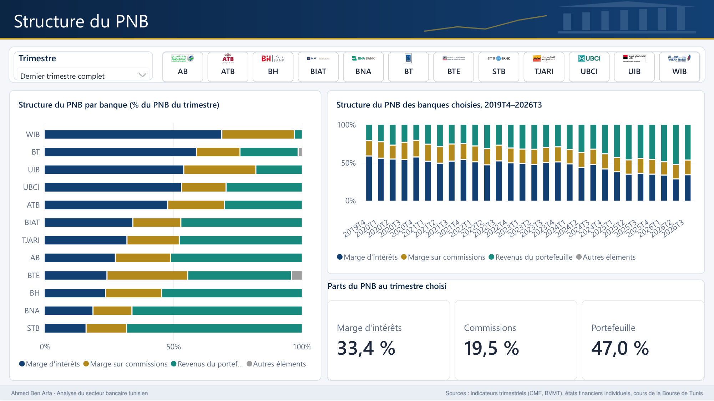
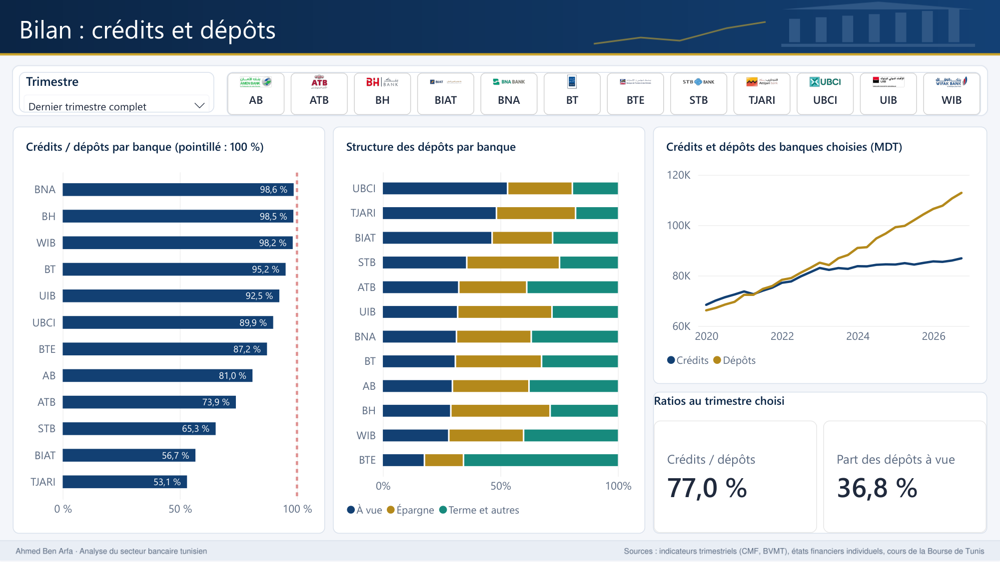
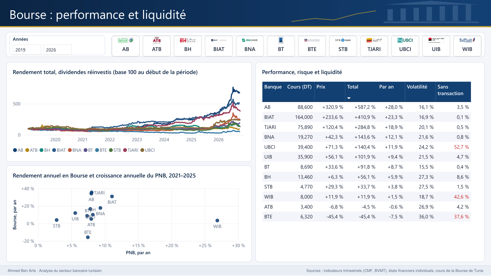
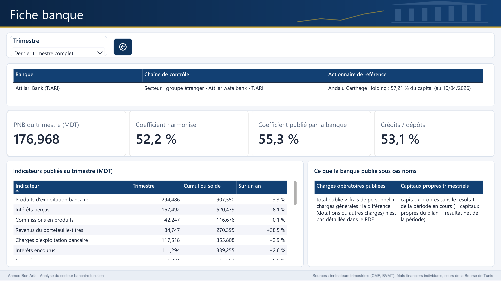
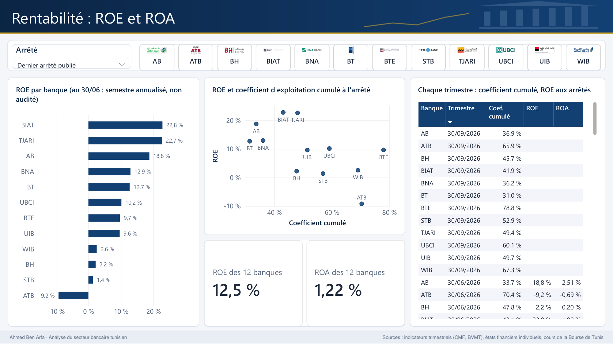

<!-- Auteur : Ahmed Ben Arfa -->
# Analyse du secteur bancaire tunisien — présentation du rapport Power BI

## 1. Le projet en bref

Le rapport compare les **12 banques cotées à la Bourse de Tunis** (AB, ATB, Attijari, BH, BIAT, BNA, BT, BTE, STB,
UBCI, UIB, Wifak), **trimestre par trimestre, du T4 2019 au T3 2026**. Il cherche à répondre à sept questions :

1. Quelles banques ont le produit net bancaire (PNB) le plus élevé, et lesquelles gagnent des parts de marché ?
2. Quelles banques sont les plus efficaces (coefficient d'exploitation), et comment cela évolue-t-il ?
3. D'où viennent leurs revenus : marge d'intérêts, commissions, portefeuille-titres ?
4. Comment ont évolué les crédits, les dépôts et la concentration du secteur ?
5. Quelles banques sont les plus rentables (ROE, ROA) ?
6. Quel a été l'effet du Covid, et comment le secteur s'est-il redressé ?
7. La Bourse récompense-t-elle les banques les plus performantes ?

Huit pages sont terminées et vérifiées (section 4) ; elles répondent aux sept questions. La neuvième page (qualité
des données) est prévue (section 5).

## 2. Les données : publications officielles, tracées et contrôlées

| Source | Contenu | Volume |
|---|---|---|
| Indicateurs d'activité trimestriels (CMF, Bourse de Tunis, sites des banques) | PNB et ses composantes, charges, crédits, dépôts, capitaux propres | 336 documents (12 banques × 28 trimestres), 11 545 valeurs retenues |
| États financiers individuels, annuels et semestriels | résultat net, total de l'actif, capitaux propres (pour le ROE et le ROA) | 168 arrêtés, 504 valeurs |
| Cours de bourse (archives et bulletins de la Bourse de Tunis) | clôtures quotidiennes, ajustées des opérations sur titres | 1 955 séances par banque, 63 opérations sur titres sourcées |

**Chaque valeur garde sa source** (fichier et page du PDF). Rien n'est estimé : une valeur absente reste vide.

**Contrôles et validation.**

- 438 valeurs relevées à la main sur l'image des PDF (41 documents) et 169 pour les états financiers (24 documents),
  comparées automatiquement à l'extraction ; 50 tests automatiques au total.
- Contrôles de cohérence à chaque extraction : produits − charges = PNB, somme des quatre trimestres = cumul
  annuel, PNB = marge d'intérêts + marge sur commissions + revenus du portefeuille.
- 13 documents publiés en image (BTE) saisis à la main avec les mêmes contrôles.
- Les banques révisent souvent leurs chiffres d'un document à l'autre : la règle retenue garde la version révisée,
  signale les révisions de plus de 2 % comme ruptures de série, et calcule les croissances sur un an dans un même
  document (valeur N et valeur N-1 publiées ensemble), pour ne jamais comparer deux bases différentes.
- Les 22 écarts annuels (somme des trimestres différente du cumul) sont tous expliqués, avec leur source.

**Limites** : les indicateurs trimestriels sont provisoires et non audités ; les définitions de certains postes
diffèrent d'une banque à l'autre (d'où un coefficient d'exploitation « harmonisé », défini de la même façon pour
toutes) ; le ROE et le ROA ne sont que semestriels et annuels.

## 3. Chaîne de traitement

**PDF publics → extraction en Python → fichiers CSV publiés → Power Query → modèle en étoile → mesures DAX → pages.**

- **Python ne fait que lire les PDF** (gabarit de mise en page par banque, contrôles, versions initiale et
  révisée). Tout le reste est fait dans Power BI, pour que les transformations restent visibles.
- **Power Query : 22 requêtes**, sur trois types de sources (dossier de fichiers CSV, classeur Excel de
  l'actionnariat, fichier CSV lu par son adresse sur GitHub) ; fusions de requêtes (dont une sur trois colonnes),
  dépivotage, colonnes conditionnelles, types avec paramètres régionaux, requêtes intermédiaires non chargées,
  paramètre de chemin, fonction personnalisée (catégorie d'actionnariat de la banque à la date de chaque valeur).
- **Modèle en étoile** : table des dates (avec la période Covid), dimensions banques et indicateurs, tables de
  faits (indicateurs, variations comparables, états financiers, cours, contrôles) ; 36 relations, dont une inactive
  activée par `USERELATIONSHIP`.
- **166 mesures DAX**, rangées en dossiers (bases, secteur, ratios, croissances, rentabilité, Bourse, qualité), avec
  des règles écrites : totaux du secteur, parts de marché et rangs seulement si les 12 banques sont présentes ;
  chiffres annuels tirés du cumul publié, jamais de la somme des trimestres ; aucun vide remplacé par zéro.
- **Documentation** : chaque requête, chaque mesure et chaque page sont expliquées dans
  `docs/Guide_PowerBI.pdf` ; chaque mesure a été vérifiée dans la vue Requête DAX contre des valeurs calculées à
  part.

## 4. Les pages construites

Toutes les pages partagent la même présentation : thème aux couleurs d'un rapport bancaire, bandeau de titre,
segment du trimestre réglé par défaut sur **« Dernier trimestre complet »** (le dernier trimestre où les 12
banques ont publié, ici le T3 2026, pour que la page reste juste quand de nouvelles publications arrivent) et
segment des banques avec leur logo.

### Page 1 — Vue d'ensemble du secteur

**Ce que la page montre** : la taille du secteur au dernier trimestre complet, son efficacité et sa concentration.

- Quatre cartes : PNB du trimestre (**1 936,6 MDT**, 12 banques présentes), coefficient d'exploitation du secteur
  (**44,7 %**, médiane des banques 47,0 %), encours de crédits (**86 880 MDT**, +2,1 % sur un an) et de dépôts
  (**112 896 MDT**, +8,2 % sur un an).
- Parts de marché du PNB : la BIAT en tête (**22,4 %**), devant la BNA (15,4 %) et la STB (10,0 %) ; les trois
  premières banques font **47,8 %** du PNB.
- Concentration dans le temps (indice de Herfindahl-Hirschman, de 1 106 à 1 209 sur la période) : marché peu
  concentré, en légère hausse.

**Choix de conception** : les cartes du secteur ne s'affichent que si les 12 banques ont publié (sinon un total
partiel passerait pour le secteur) ; la courbe de concentration ignore le segment du trimestre pour montrer toute
la période.

### Page 2 — Classement des banques

**Ce que la page montre** : le classement des 12 banques au trimestre choisi, sur la taille, l'efficacité et la
croissance.

- Tableau : PNB, part de marché et rang ; coefficient d'exploitation harmonisé ((frais de personnel + charges
  générales) / PNB) et son rang ; écart à la médiane des banques, en vert si la banque fait mieux que la médiane, en
  rouge sinon ; croissance du PNB sur un an.
- Au T3 2026 : la BIAT est première au PNB, la **BT la plus efficace (coefficient de 30,1 %)**, la BTE la moins
  efficace (82,4 %) ; six banques font mieux que la médiane (47,0 %).
- Nuage de points croissance × efficacité, taille des points = PNB, avec un **axe de lecture** (bouton ▶) qui fait
  défiler les 28 trimestres : on voit par exemple le choc de 2020 (au T2 2020, PNB de l'UIB −78,7 % sur un an,
  effet du moratoire Covid sur les intérêts).

**Choix de conception** : le classement utilise le coefficient harmonisé et non celui publié par chaque banque, dont
le contenu varie (avec ou sans dotations aux amortissements) ; la couleur vient d'une mesure du modèle, la règle
est donc écrite une seule fois.

### Page 3 — Évolution 2020–2026

**Ce que la page montre** : chaque banque trimestre par trimestre, sur l'indicateur choisi dans le sélecteur
(PNB, coefficient d'exploitation, crédits / dépôts, part du PNB, croissance du PNB sur un an), avec la période Covid
marquée par deux lignes verticales (mars 2020 et fin 2021).

- Un **paramètre de champ** change l'indicateur de toutes les courbes sans dupliquer le graphique.
- Les **sauts de série** sont expliqués : les révisions de plus de 2 % (174 sur les cinq indicateurs de la page,
  pour toutes les banques) et les événements datés et sourcés (don au Fonds 1818 en 2020, accord salarial
  APTBEF–FGBEF en 2021, moratoire Covid de l'UIB, retraitement de la BH en 2024) apparaissent dans l'info-bulle de
  chaque point et dans deux tableaux à droite.
- Lecture : au T2 2020, le PNB trimestriel est inférieur à celui du T4 2019 pour 10 banques sur 12 (toutes sauf
  l'ATB et la BT), et c'est le point bas de 2020–2021 pour 8 d'entre elles (BIAT : 264,3 MDT au T4 2019, 224,3 au
  T2 2020) ; puis reprise : la BIAT atteint 433,3 MDT au T3 2026.

**Choix de conception** : axe des dates continu (les 28 trimestres sans défilement) ; courbes droites entre deux
trimestres, sans lissage, pour ne pas dessiner de creux ou de pics qui n'existent pas dans les données.

### Page 4 — Structure du PNB

**Ce que la page montre** : de quoi est fait le PNB de chaque banque au trimestre choisi, et comment la structure
du secteur a changé depuis 2019. Le PNB y est découpé en marge d'intérêts (intérêts perçus − intérêts encourus),
marge sur commissions (commissions perçues − commissions encourues), revenus du portefeuille-titres et autres
éléments.

- Barres à 100 % par banque, triées par part de la marge d'intérêts : au T3 2026, **Wifak** (banque islamique) tire
  **68,7 %** de son PNB de sa marge, la **STB** seulement **15,8 %** ; à l'inverse, le portefeuille fait **68,4 %** du
  PNB de la STB et **66,3 %** de celui de la BNA.
- Secteur au T3 2026 (carte) : marge d'intérêts **33,4 %**, commissions **19,5 %**, portefeuille **47,0 %**.
- Dans le temps (histogramme, 28 trimestres) : la part de la marge d'intérêts passe de **58,2 %** au T4 2019 à
  **33,4 %** au T3 2026, celle du portefeuille de **21,5 %** à **47,0 %** ; les commissions restent entre 18 % et 20 %.
  Les données montrent ce déplacement ; elles n'en donnent pas la cause, que le rapport n'avance pas.

**Choix de conception** : des barres à 100 % pour comparer la composition sans que la taille des banques écrase les
petites ; un quatrième élément, « autres éléments » (en gris), garde le reste du PNB hors des trois composantes pour
que chaque barre fasse exactement 100 % : il n'existe que chez la BTE (gains de change, 4,3 %) et la BT (1,7 %).
Le contrôle « PNB = somme des composantes », ajouté pour cette page, a fait trouver une erreur de lecture d'un PDF
(Wifak, T2 2026 : deux nombres collés), corrigée avant la construction de la page.

### Page 5 — Bilan : crédits et dépôts

**Ce que la page montre** : comment chaque banque finance ses crédits par les dépôts de sa clientèle, de quoi sont
faits ces dépôts, et comment le bilan du secteur a évolué depuis 2019.

- Ratio crédits / dépôts par banque au T3 2026, avec une ligne à 100 % (crédits = dépôts) : de **98,6 %** (BNA),
  98,5 % (BH) et 98,2 % (Wifak) à **53,1 %** (Attijari) et 56,7 % (BIAT) ; toutes les banques sont sous 100 %.
- Structure des dépôts : la part des dépôts à vue (ressources peu coûteuses) va de **52,7 %** (UBCI) à **17,4 %**
  (BTE, dont deux tiers des dépôts sont à terme ou autres).
- Secteur (carte) : crédits / dépôts **77,0 %**, dépôts à vue **36,8 %** des dépôts.
- Dans le temps : en 2019 et 2020, les crédits dépassaient les dépôts (ratio de **103,3 %** fin 2019) ; les dépôts
  passent devant au T2 2021, puis l'écart se creuse : de fin 2022 au T3 2026, les dépôts passent de 85 143 à
  **112 896 MDT** (+33 %), les crédits de 83 044 à **86 880 MDT** (+5 %), et le ratio tombe à 77,0 %. Les données
  montrent l'écart ; elles n'en donnent pas la cause, que le rapport n'avance pas.

**Choix de conception** : seules 4 banques publient leurs dépôts à terme à part ; pour que la structure couvre les
12 banques, une mesure prend le reste des dépôts (dépôts − à vue − épargne), banque par banque, et reste vide si une
banque n'a pas publié le détail, plutôt que de mélanger des banques avec et sans détail. Les encours sont pris à la
fin de chaque trimestre, jamais additionnés dans le temps.

### Page 6 — Bourse : performance et liquidité

**Ce que la page montre** : ce qu'a rapporté l'action de chaque banque, avec quel risque et quelle liquidité, et si
la Bourse a suivi la croissance de l'activité. Un curseur des années remplace le segment du trimestre : une
performance se mesure entre deux dates ; sans réglage, la page couvre toute la période des cours (du 02/01/2019 au
20/10/2026).

- Tableau : dernier cours, performance du prix, rendement total (dividendes réinvestis), rendement annuel moyen,
  volatilité et part des séances sans transaction. Sur la période : **AB +587,2 %** (+28,0 % par an), BIAT +410,9 %,
  Attijari +284,8 % ; à l'autre bout, ATB −4,5 % et **BTE −45,4 %**.
- Liquidité : en rouge, les titres sans aucune transaction à plus de 20 % des séances, **UBCI (52,7 %), Wifak
  (42,6 %) et BTE (37,6 %)** : leur volatilité et leur performance reposent sur peu d'échanges.
- Courbes en base 100 au début de la période : des actions de 3 DT et de 164 DT sur la même échelle.
- Nuage 2021–2025 : rendement annuel en Bourse face à la croissance annuelle du PNB. La Bourse n'a pas suivi le PNB
  banque par banque : Wifak a la croissance du PNB la plus forte (+26,9 % par an) et un rendement de +3,5 % par an ;
  Attijari, AB et BIAT dépassent +30 % par an avec une croissance du PNB de 8 à 11 %. Les données montrent l'écart ;
  elles n'en donnent pas la cause, que le rapport n'avance pas.

**Choix de conception** : les performances sont calculées sur des cours ajustés des opérations sur titres
(attributions gratuites, division du nominal, dividendes : 63 opérations sourcées, facteurs publiés par la Bourse),
sinon une attribution gratuite passerait pour une chute du cours ; le rendement est ramené à un an pour être comparé
à une croissance annuelle, et reste vide pour une période de moins d'un an.

### Page 7 — Fiche banque

**Ce que la page montre** : tout ce qu'on sait d'une banque au trimestre choisi. On l'ouvre depuis n'importe quelle
autre page : clic droit sur une banque › **Extraire** › **Fiche banque** (page d'extraction) ; la capture montre la
fiche d'Attijari au T3 2026.

- Identité : nom, **chaîne de contrôle** (« Secteur › groupe étranger › Attijariwafa bank › TJARI ») et actionnaire
  de référence avec sa part du capital (Andalu Carthage Holding, 57,21 %).
- Chiffres du trimestre : PNB **176,968 MDT**, coefficient harmonisé **52,2 %** à côté du coefficient publié par la
  banque (**55,3 %** : ses charges opératoires comprennent un reste non détaillé), crédits / dépôts 53,1 %.
- Tous les indicateurs publiés (trimestre, cumul ou solde, variation sur un an), dont les capitaux propres
  trimestriels, avec à droite ce que la banque met sous ces noms.

**Choix de conception** : la chaîne de contrôle vient d'une hiérarchie parent-enfant (secteur › catégorie
d'actionnariat › groupe › banque, 27 nœuds) parcourue par les fonctions DAX `PATH`, `PATHITEM`, `PATHLENGTH` et
`PATHCONTAINS`. Le coefficient publié et les capitaux propres trimestriels n'apparaissent que sur cette page, avec leur
définition : leur contenu change d'une banque à l'autre, ils ne servent à aucune comparaison. Ouverte sans banque, la
page reste vide et indique comment l'ouvrir.

### Page 8 — Rentabilité : ROE et ROA

**Ce que la page montre** : quelles banques sont les plus rentables, et si la rentabilité suit l'efficacité. Le ROE
(résultat net / capitaux propres moyens) et le ROA (résultat net / total de l'actif moyen) viennent des états
financiers individuels : ils n'existent qu'au 30/06 (semestre **annualisé**, comptes **non audités**) et au 31/12. La
page a donc un segment des **arrêtés** (« Dernier arrêté publié », ici le 30/06/2026) au lieu du trimestre.

- ROE par banque au S1 2026 : **BIAT 22,8 %**, Attijari 22,7 %, AB 18,8 %… jusqu'à **ATB −9,2 %** (perte) ; les 12
  banques ensemble : **ROE 12,5 %, ROA 1,22 %**. En 2024 : 11,8 % et 1,19 %, BTE à −63,7 %.
- Nuage ROE × coefficient d'exploitation cumulé à la même date : les banques les plus efficaces (AB, BT, BNA, BIAT)
  sont parmi les plus rentables ; ATB et Wifak, coefficients élevés, ont un ROE faible ou négatif. BTE fait exception
  au S1 2026 (ROE 9,7 % avec un coefficient de 78 %) : ses capitaux propres, très réduits par les pertes passées,
  grossissent le ratio.
- Tableau de tous les trimestres : coefficient cumulé à chaque trimestre, ROE et ROA aux seuls 30/06 et 31/12.

**Choix de conception** : deux **jointures DAX** réunissent les deux sources. `NATURALINNERJOIN` réunit le ROE des
états financiers et le coefficient des indicateurs trimestriels sur la banque et la date : seules les dates
présentes des deux côtés restent (168 lignes, les 30/06 et 31/12), ce que montre le nuage. `NATURALLEFTOUTERJOIN`
garde tous les trimestres (336 lignes) et n'y ajoute le ROE que là où il existe, ce que montre le tableau. Les
colonnes de jointure sont réécrites pour perdre leur lien avec la colonne d'origine (sinon DAX refuse la jointure),
et un test refait les deux jointures depuis les données publiées.

## 5. Suite du rapport

| Page | Contenu prévu | Question |
|---|---|---|
| 9. Qualité des données | statut de chaque document, révisions, écarts expliqués, sources et limites | — |

Fonctions DAX ajoutées pendant la construction des pages : hiérarchie parent-enfant `PATH`, `PATHITEM`,
`PATHLENGTH`, `PATHCONTAINS` (page 7), jointures `NATURALINNERJOIN` et `NATURALLEFTOUTERJOIN` (page 8). Ensuite :
publication du rapport sur le web, captures et page d'accueil du dépôt.

**Dépôt du projet** : https://github.com/AhmedBenArfa/Analyse-secteur-bancaire-tunisien — code, données publiées,
projet Power BI, spécification (`docs/Specification_projet.pdf`), guide de chaque transformation
(`docs/Guide_PowerBI.pdf`) et rapport d'avancement (`docs/Rapport_avancement.pdf`).
